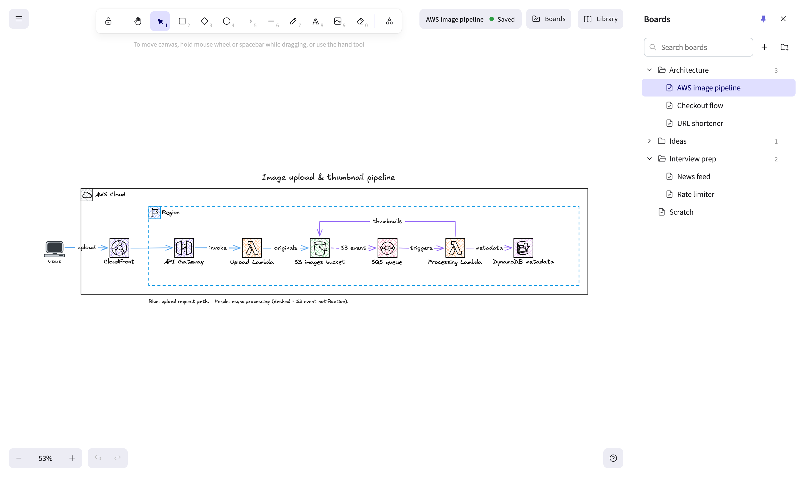
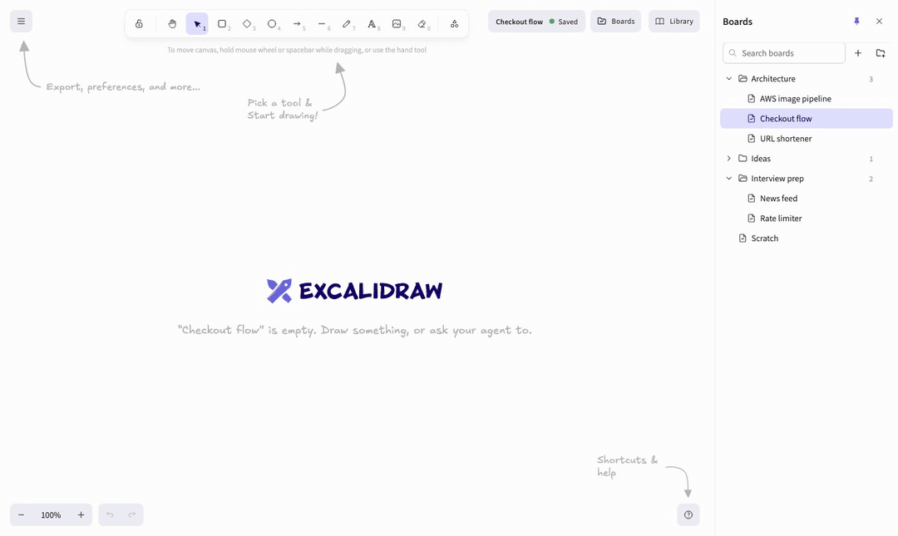

<div align="center">

# Excalidraw Boards

**Self-hosted Excalidraw with boards in folders, and an MCP server so your AI agent can draw on them.**



</div>

The [Excalidraw](https://excalidraw.com) editor you know, plus the two things it does not do on its own:

- **Boards.** As many boards as you like, in nested folders, saved on your server as plain `.excalidraw` files. Nothing lives in browser storage, and there is nothing to export.
- **MCP.** An endpoint that lets Claude Code, Cursor, VS Code or any other MCP client read and draw on your boards. A board you have open updates live while the agent draws.

## Quick start

```sh
git clone https://github.com/yashagw/excalidraw-boards.git
cd excalidraw-boards
docker compose up -d
```

The first start builds the image, which takes a minute or two. Then open **http://localhost:3779** and start drawing. Boards are saved in `./data/boards`.

> [!WARNING]
> There is no login. Anyone who can reach the port can read and edit every board. Keep it on your machine or a private network (Tailscale, WireGuard, a VPN). See [self-hosting](docs/self-hosting.md).

<details>
<summary>Without Docker</summary>

Node.js 22 or newer:

```sh
npm install
npm run build
npm start            # http://localhost:3779, boards in ./data
```

</details>

## Boards

- **Boards sidebar** (top right): create boards and folders, double-click to rename, drag onto a folder to move, search by name. Deleted boards go to `data/trash/`, not into the void.
- **Autosave** half a second after you stop drawing. Every board has its own URL, like `/b/Work/Architecture`.
- **Plain files.** `data/boards/Work/Architecture.excalidraw` is exactly what Excalidraw's "Save to disk" writes: open it on excalidraw.com, keep it in git, back it up with `rsync`.
- **Safe to share.** Two tabs, or you and an agent, can edit the same board: changes merge per element. A save can never drop elements, and earlier versions are kept in `data/history/`.
- **Your shape library** is stored on the server too, so it follows you to every device.

More in [docs/boards.md](docs/boards.md).

## Let your agent draw



Add the MCP server to your client. For Claude Code:

```sh
claude mcp add --transport http excalidraw http://localhost:3779/mcp
```

For Cursor, VS Code and others, see [docs/mcp.md](docs/mcp.md#connect-a-client). Then ask:

> *Draw our checkout flow on a new board "Architecture/Checkout flow".*

| Tools | What they do |
|---|---|
| `list_boards`, `read_board` | See which boards exist and what is on one |
| `create_board`, `add_elements` | Draw: shapes with labels, arrows that attach to shapes |
| `update_elements`, `delete_elements` | Move, restyle, relabel or remove elements |
| `search_library` | Find icons in your library (AWS, system design, …) to place by name |
| `move_board`, `drawing_guide` | Rename or move a board; the format guide agents read first |

Agents send ordinary Excalidraw elements with two shortcuts: a `label` on any shape, and arrows that name the shapes they connect. The server routes and binds them, using Excalidraw's own converter:

```json
[
  { "type": "rectangle", "id": "api", "x": 0, "y": 0, "width": 180, "height": 80, "label": "Orders API" },
  { "type": "ellipse", "id": "db", "x": 300, "y": 0, "width": 160, "height": 80, "label": "Postgres" },
  { "type": "arrow", "start": { "id": "api" }, "end": { "id": "db" }, "label": "insert" }
]
```

More in [docs/mcp.md](docs/mcp.md).

## Docs

- [Boards](docs/boards.md): folders, autosave, merging, history, trash and the library
- [MCP](docs/mcp.md): connecting clients, the tools, the element format, library icons
- [Self-hosting](docs/self-hosting.md): Docker, reverse proxies, security, backups, configuration
- [Development](docs/development.md): how the code is laid out, running it locally, tests

## Credits

Built on [Excalidraw](https://github.com/excalidraw/excalidraw): the editor is the official `@excalidraw/excalidraw` package, not a fork. The drawing guide agents read is adapted from the official [excalidraw-mcp](https://github.com/excalidraw/excalidraw-mcp). Both are MIT licensed, and so is this project ([LICENSE](LICENSE)).
