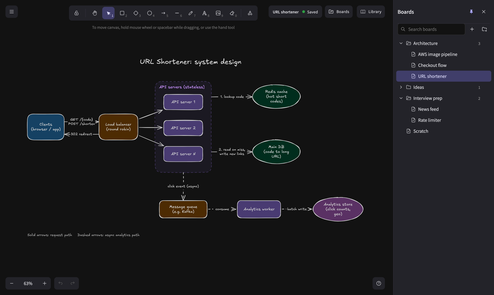

# Boards

A board is one Excalidraw drawing. Boards live in folders, and both are plain
files and directories on the server.



## The Boards sidebar

Open it with **Boards** in the top right, or from the main menu. On a wide screen
it can stay docked (the pin icon).

| To | Do |
|---|---|
| Create a board or folder | `+` (board) or the folder icon at the top; inside a folder, its `⋯` menu |
| Open a board | Click it. Its URL is `/b/<folder>/<board>`, so you can bookmark it |
| Rename | Double-click, or `⋯` → Rename |
| Move | Drag onto a folder (or onto empty space for the top level), or `⋯` → Move to… |
| Delete | `⋯` → Move to trash |
| Find | Type in the search box; Enter opens the first match |

When the app starts it opens the board in the URL, else the board changed most
recently, else it makes an "Untitled" one.

## Where boards are stored

Everything is under the data directory (`./data` with Docker Compose, `/data` in
the container):

```
data/
├── boards/                       one .excalidraw file per board
│   ├── Scratch.excalidraw
│   └── Work/
│       └── Architecture.excalidraw
├── trash/                        deleted boards and folders, named by when
├── history/                      earlier versions of each board
└── library.excalidrawlib         your shape library
```

A board file is the same JSON as Excalidraw's own "Save to disk", so it opens on
excalidraw.com or anywhere else that reads `.excalidraw`. You can also copy
`.excalidraw` files into `data/boards/` by hand; they show up in the sidebar after
a reload.

## Saving

There is no save button. A board saves about half a second after you stop
drawing (at most three seconds during continuous drawing), and again when you
switch boards or hide the tab. The badge in the top right shows the board name
and **Saved**, **Saving…**, or a problem (offline, retrying).

### Several tabs, and agents

Every Excalidraw element carries a version number. When a save arrives, the
server merges it element by element with what it has: for each element the newer
version wins. A tab that has a board open receives the result live. So you can
keep the same board open in two tabs, or edit while an agent draws, and nobody's
changes are lost.

A save never removes an element just because it is missing. Elements are removed
only by Excalidraw's own deletion (a "tombstone"), so a broken or out-of-date
client cannot wipe a board.

### History

Before a board is overwritten, the previous version is copied to
`data/history/<board>/<time>.excalidraw`, at most once every 10 minutes, keeping
the newest 50 per board. To go back, copy one of them over the board file.

### Trash

Deleting a board or folder moves it to `data/trash/`, prefixed with the time it
was deleted. To restore it, move it back into `data/boards/`. Nothing empties the
trash for you.

## The library

Excalidraw's shape library (the **Library** button) is kept on the server in
`data/library.excalidrawlib`, so it is the same in every browser. Add items by
selecting shapes and choosing **Add to library**, or install packs from
[libraries.excalidraw.com](https://libraries.excalidraw.com) with **Browse
libraries**. Popular ones for diagrams: *AWS Architecture Icons*, *System Design
Components*, *Software Architecture*, *Network topology icons*.

Agents can place library items by name too; see [MCP](mcp.md#library-icons).

## What is not here

- **Accounts and sharing.** Everyone who can reach the server sees every board.
- **Live cursors** of other people, as on excalidraw.com. Changes still sync
  between tabs.
- **"Open" from the main menu.** It would mix the file into the current board, so
  it is removed; copy the file into `data/boards/` instead.
